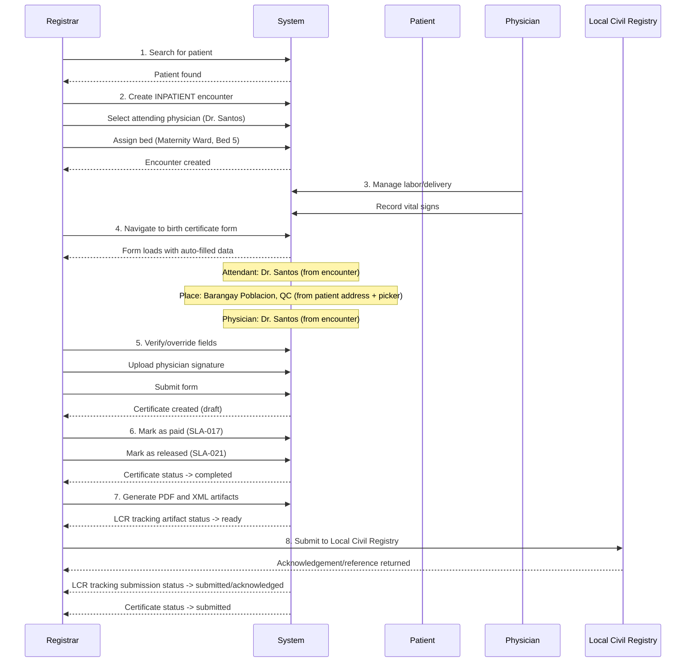

# Birth Certificate Workflow

## End-to-End Flow

1. ADMISSION (Registrar)
   - Patient arrives at facility.
   - Registrar searches for patient, or creates a new patient record.
   - Registrar creates an inpatient encounter:
     - Selects attending physician, for example Dr. Maria Santos.
     - Assigns bed, for example Maternity Ward, Bed 5.
     - Encounter is created with `attendingStaffId`, `bedId`, and ward/bed context.
   - Patient is admitted to the ward.

2. DELIVERY (Clinical Staff)
   - Attending physician manages labor and delivery.
   - Newborn is born.
   - Clinical staff record encounter activity and vital signs.
   - Encounter remains active while care continues.

3. BIRTH CERTIFICATE GENERATION (Registrar)
   - Registrar navigates to `/registrar/civil-registry/birth`.
   - Registrar searches for the newborn patient if the URL has no `patientId`.
   - Form loads with auto-filled data when available:
     - Attendant at Birth: from `encounter.attendingStaffName`.
     - Place of Birth: from patient address plus the location picker.
     - Physician Name: from `encounter.attendingStaffName`.
     - Physician License: from `encounter.attendingStaffLicenseNo`.
   - Registrar verifies or overrides fields as needed.
   - Registrar uploads physician signature.
   - Registrar creates the birth registration.
   - Certificate is created with status `draft`.

4. PAYMENT & RELEASE (Registrar/Admin)
   - Family pays for the certificate.
   - Registrar marks the certificate as paid (SLA-017).
   - Registrar marks the certificate as released (SLA-021).
   - Certificate status becomes `completed`.

5. SUBMISSION TO LCR (Registrar)
   - Registrar generates the LCR PDF artifact.
   - Registrar generates the LCR XML artifact.
   - `lcr_tracking` records artifact readiness for the birth registration source record.
   - Registrar submits to Local Civil Registry.
   - `lcr_tracking` stores submission status, acknowledgement number, reference number, and any last submission error.
   - Certificate status becomes `submitted`.
   - Tracking entry is updated.

## Data Flow Diagram

```text
Patient Registration
        |
        v
Encounter Created
(attendingStaffId, bedId, wardName)
        |
        v
Delivery Occurs
        |
        v
Birth Certificate Form
(auto-fills from encounter + patient address)
        |
        v
Registrar Verifies/Overrides
        |
        v
Certificate Submitted
        |
        v
Payment & Release Tracking
```

## Sequence



## Admission to Birth Certificate Data Flow

```text
ADMISSION PHASE
├─ Patient Record
│  ├─ firstName, lastName, dateOfBirth
│  ├─ addressLine1, addressLine2
│  ├─ city (for example "Quezon City")
│  └─ province (for example "Metro Manila")
│
├─ Encounter Record
│  ├─ attendingStaffId (for example "uuid-of-dr-santos")
│  ├─ attendingStaffName (for example "Dr. Maria Santos")
│  ├─ attendingStaffLicenseNo (for example "0123456")
│  ├─ bedId (for example "uuid-of-bed-5")
│  ├─ wardName (for example "Maternity Ward")
│  └─ bedNumber (for example "5")
│
└─ Staff Profile (Attending Physician)
   ├─ firstName, lastName
   ├─ prcLicenseNumber (for example "0123456")
   └─ department/specialization context

BIRTH CERTIFICATE GENERATION PHASE
├─ Form Auto-Fill
│  ├─ Attendant at Birth <- encounter.attendingStaffName
│  ├─ Place of Birth <- patient.city + patient.province + location picker
│  ├─ Physician Name <- encounter.attendingStaffName
│  ├─ Physician License <- encounter.attendingStaffLicenseNo
│  └─ Attending Staff ID <- encounter.attendingStaffId
│
└─ Birth Registration Record
   ├─ patientId
   ├─ encounterId
   ├─ attendantAtBirth
   ├─ placeOfBirthBarangay
   ├─ placeOfBirthMunicipality
   ├─ placeOfBirthProvince
   ├─ placeOfBirthRegion
   ├─ physicianName
   ├─ physicianLicenseNo
   ├─ attendingStaffId
   └─ status (draft -> completed -> submitted)

LCR TRACKING PHASE
├─ lcr_tracking
│  ├─ certificateType = birth
│  ├─ sourceRecordId = birthRegistrations.id
│  ├─ pdfStatus / pdfGeneratedAt / pdfUrl
│  ├─ xmlStatus / xmlGeneratedAt / xmlUrl
│  ├─ submissionStatus
│  ├─ acknowledgementNumber
│  ├─ referenceNumber
│  └─ lastSubmissionError / lastSubmissionErrorAt
```
